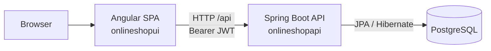
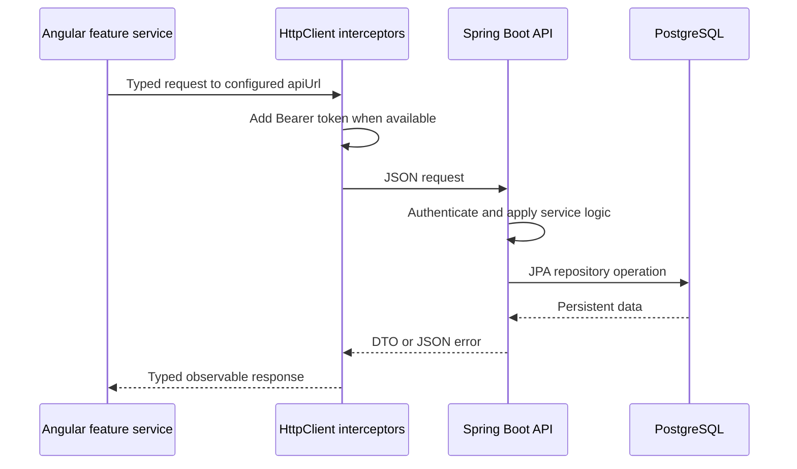

# Architecture

The application delivers a browser-based shop backed by a stateless REST API. Angular provides the customer and administrator experience, Spring Boot enforces business rules and authorization, and PostgreSQL stores the catalogue, inventory, users, and orders.

## System boundaries

The frontend owns presentation state and the browser-local cart. The backend owns identities, roles, product and category management, stock allocation, orders, and persistent state. The API is the only integration boundary between the frontend and the database.

| Component | Technology | Responsibility |
|---|---|---|
| `onlineshopui` | Angular 21 standalone SPA | Renders features, manages client state, enforces route access, and calls the API |
| `onlineshopapi` | Java 21, Spring Boot | Exposes REST endpoints, applies security and business rules, and persists domain data |
| PostgreSQL | PostgreSQL 18 | Stores relational application data managed through Flyway migrations |

## Backend architecture

`OnlineShopApiApplication` starts the Spring Boot application. It runs on port `3000` with `/api` as the servlet context path. Spring Data JPA manages persistence while Hibernate validates, rather than generates, the Flyway-managed schema.

| Package | Responsibility |
|---|---|
| `controller` | Defines authentication, product, category, and order endpoints |
| `dto` and `dto.mapper` | Keeps HTTP request/response types separate from JPA entities |
| `service` | Implements registration, login, catalogue operations, and transactional order creation |
| `service.strategy` | Selects stock locations for an order |
| `repository` | Provides Spring Data JPA access to the domain model |
| `model` | Defines JPA entities, embedded address data, composite keys, and user roles |
| `security` | Configures stateless security, JWT processing, and user details |
| `exception` | Maps domain and security failures to JSON HTTP responses |
| `config` | Configures the OpenAPI definition |

Controllers delegate to services and map entities to DTOs at the HTTP boundary. Repository access remains in the service layer.

### API surface

All paths are relative to `/api`.

| Resource | Endpoints | Access |
|---|---|---|
| Authentication | `POST /auth/register`, `POST /auth/login`, `GET /auth/profile` | Registration and login are public; profile requires authentication |
| Products | `GET /products`, `GET /products/{id}`, `POST`, `PUT /{id}`, `DELETE /{id}` | Authentication required; writes require `ADMIN`; create/update include required supplier ID and responses include supplier |
| Categories | `GET /products/categories`, `GET /products/categories/{id}`, `POST`, `PUT /{id}`, `DELETE /{id}` | Authentication required; writes require `ADMIN` |
| Suppliers | `GET /suppliers`, `GET /suppliers/{id}` | Authentication required; read-only |
| Orders | `GET /orders`, `GET /orders/{id}`, `POST /orders` | Authentication required |

Spring Security permits only registration, login, and OpenAPI/Swagger paths without a token. `@PreAuthorize` adds the `ADMIN` restriction to product and category writes. Springdoc publishes the OpenAPI definition and Swagger UI.

### Order processing

`OrderService.createOrder` is transactional. It resolves the authenticated user, merges duplicate requested products, selects stock through an `OrderStrategy`, creates order details with their shipping locations, and deducts stock before committing the order.

`app.order.strategy` selects the allocation policy:

- `SINGLE_LOCATION` is the configured default. It fulfils the complete order from one location with sufficient inventory.
- `MOST_ABUNDANT` selects the highest-stock location for each requested product, so an order can ship from multiple locations.
- `MULTI_LOCATION` selects the highest-stock location first for each product, then continues with the next-most-stocked locations until the requested quantity is covered.

An unfulfillable order returns HTTP `422`. The global exception handler also returns `409` for duplicate resources and products referenced by orders, `404` for missing resources, `403` for access denial, and `401` for invalid credentials.

## Frontend architecture

`src/main.ts` bootstraps the standalone Angular application with `appConfig`. The configuration registers the router, `HttpClient`, functional interceptors, environment settings, validation messages, icons, and an initializer that restores the authenticated profile when a token exists.

| Area | Responsibility |
|---|---|
| `app.routes.ts` | Defines the root route tree and lazy-loads feature routes |
| `clib` | Provides shared components and the protected root layout with navigation, notifications, and a router outlet |
| `core` | Supplies shared types, configuration, environment providers, notifications, and the mock API |
| `features/auth` | Handles login, registration, token lifecycle, profile state, guards, and the auth interceptor |
| `features/products` | Provides catalogue, detail, and administrator product-management views |
| `features/cart` | Manages the local cart and checkout flow |
| `features/orders` | Provides order history, details, and creation |

Feature routes and page components are lazy-loaded. `authGuard` protects the root layout and its product, cart, and order routes. `guestGuard` protects login and registration pages. Product creation and updates additionally require `ADMIN` through `rolesGuard`.

Angular services use signals for reactive client state. `ProductService` and `OrdersService` hold fetched collections, selected records, loading state, and error state. `CartService` persists `cart_state` in `localStorage`; cart contents reach the API only when the user creates an order.

## Authentication and authorization

Authentication is JWT-based and stateless:

1. `POST /auth/register` rejects duplicate email addresses, BCrypt-hashes the password, and assigns the `CUSTOMER` role.
2. `POST /auth/login` authenticates credentials and returns a signed token whose subject is the user's email.
3. `AuthService` stores the token as `access_token` in `localStorage`, then loads `/auth/profile` to establish the current user and role state.
4. `authTokenInterceptor` adds `Authorization: Bearer <token>` to outgoing requests while a token exists.
5. `JwtAuthFilter` verifies the token's signature and expiry, loads user details, and puts their authorities in Spring Security's context.
6. Backend method security and frontend route guards both enforce role-specific access; the backend remains the authorization authority.

The backend signs JWTs with the Base64 secret in `app.jwt.secret`; `app.jwt.expiration` controls their lifetime. It disables server sessions and CSRF, and configures CORS from `app.cors.allowed-origins`.

## Frontend-backend communication

Feature services construct typed `HttpClient` requests from the injected `EnvironmentConfig`:

The development environment targets `http://localhost:3000/api`. The production and default environments use the `${API_URL}` placeholder. The mock environment targets `http://mock-api`; its interceptor responds locally for authentication, products (including suppliers), and orders with a simulated delay, allowing frontend development without the backend.

## Database

Flyway owns the PostgreSQL schema. The base migration is `onlineshopapi/src/main/resources/db/migration/V1__create_tables.sql`; the local profile also runs migrations from `db/migration/local` to seed development data.

| Table | Purpose and relationships |
|---|---|
| `product_categories` | Holds category data for products |
| `suppliers` | Holds supplier names and optional contact and address data |
| `products` | Holds catalogue items; each product references a category and a required supplier |
| `locations` | Holds stock and shipping locations |
| `stocks` | Holds quantity per product and location; primary key: `product_id`, `location_id` |
| `users` | Holds user identities and roles; email is unique |
| `orders` | Holds user-owned orders and delivery-address data |
| `order_details` | Holds ordered product quantities and shipping locations; primary key: `order_id`, `product_id`, `shipped_from_id`, allowing one product to ship from multiple locations in an order |

The development Compose stack runs PostgreSQL 18, exposes container port `5432` on host port `5434`, and persists data in `shop-data-volume`. Production datasource settings come from environment variables: database host, port, name, username, and password.

## Configuration

Backend runtime settings live in `onlineshopapi/src/main/resources/application.yml`, with profile overrides such as `application-local.yml`. Deployments provide datasource settings, `JWT_SECRET`, and `CORS_ALLOWED_ORIGINS`.

Angular file replacements select development, mock, or production environment configuration. The selected environment supplies the API URL and determines whether the mock interceptor is active.
